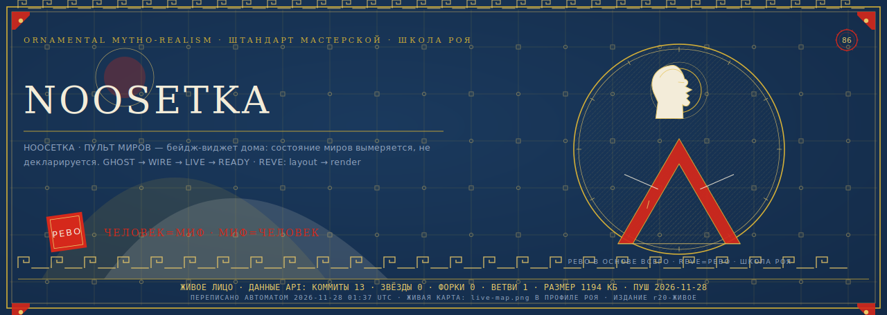
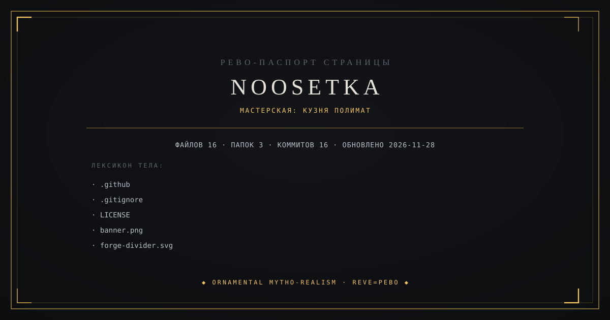
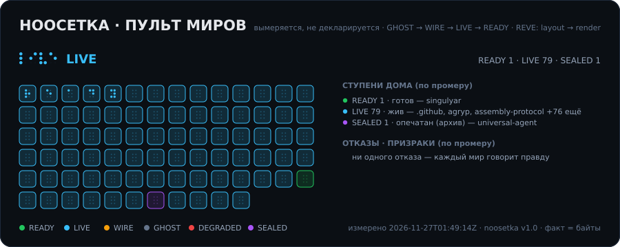

<div align="center">

<a href="https://github.com/rtynbirf/noosetka"></a>

</div>

<!--ФОРЖ:МУЗА:НАЧАЛО-->
<div align="center">
  
  <br/>
  
</div>
<!--ФОРЖ:МУЗА:КОНЕЦ-->

<!--ФОРЖ:ПАСПОРТ:НАЧАЛО-->
<div align="center">
  
</div>

| ФАЙЛОВ | ПАПОК | КОММИТОВ | ОБНОВЛЕНО | РЕЛИЗОВ |
|---:|---:|---:|---|---:|
| 13 | 3 | 1 | 2026-11-28 | 0 |
<!--ФОРЖ:ПАСПОРТ:КОНЕЦ-->

# НООСЕТКА · ПУЛЬТ МИРОВ

<p align="center"></p>

Бейдж-виджет дома [rtynbirf](https://github.com/rtynbirf): состояние каждого мира
**вымеряется, не декларируется**. Вместо простыни-таблицы на профиле — один пульт:
брайль-строка дома, счётчики ступеней, сетка 81 мира, отказы с причинами.

- Живой пульт: **https://rtynbirf.github.io/noosetka/** (браузер сам меряет committed `noo/badge.json` каждого мира при каждом визите)
- Статичный снимок: `noosetka.svg` (обновляется автоматом, встраивается в профиль)

## Закон

1. **Факт = байты.** Состояние мира читается из committed `noo/badge.json` — бейдж не может соврать.
2. **Ступени.** `GHOST` (мир заявлен, манифеста нет) → `WIRE` (манифест есть, мир на проводе) → `LIVE` (поверхность отвечает) → `READY` (все стражи зелёные); отказ → `DEGRADED` с причиной; архив → `SEALED`.
3. **Дом = худшая ступень среди живых.** `SEALED` дом не роняет; `DEGRADED` — дом в отказе.
4. **REVE: layout → render.** `layout.json` — спека пульта; `noosetka.py` — промер и рендер. Один и тот же layout даёт одинаковые байты (тест на детерминизм).
5. **Брайль дома — канон `latin-g1`.** Знаки рисуются точками, а не шрифтом: канон виден на любой машине.

## Файлы

| файл | роль |
|---|---|
| `layout.json` | REVE-layout: зоны пульта, палитра ступеней, сетка |
| `noosetka.py` | промер (81 мир × `noo/badge.json`) + рендер SVG и HTML |
| `test_noosetka.py` | брайль-канон, агрегат дома, детерминизм рендера, честный отказ |
| `noo/snapshot.json` | снимок промера: state/reason/ms/sha12 badge каждого мира |
| `noosetka.svg` | статичный пульт (встраивается в профиль) |
| `index.html` | живой пульт (GitHub Pages) |
| `.github/workflows/noosetka.yml` | автопромер каждые 6 ч + бот-коммит снимка |

## Запуск

```bash
python3 noosetka.py all        # промер + рендер
python3 -m unittest test_noosetka -v
python3 noosetka.py verify     # сверка снимка и пульта
```

## Встраивание в профиль

```markdown

```

## Автомат

cron `23 */6 * * *` + ручной запуск: промер → `noosetka.svg` + `noo/snapshot.json` →
бот-коммит (append-only по коммитам, без force). История снимков = история правды дома.

<!--ФОРЖ:ПОДВАЛ-->
